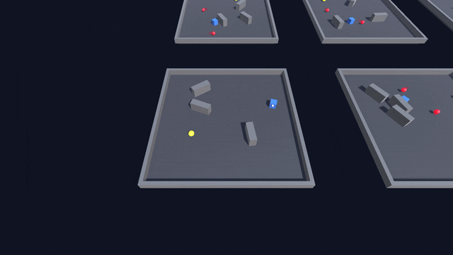
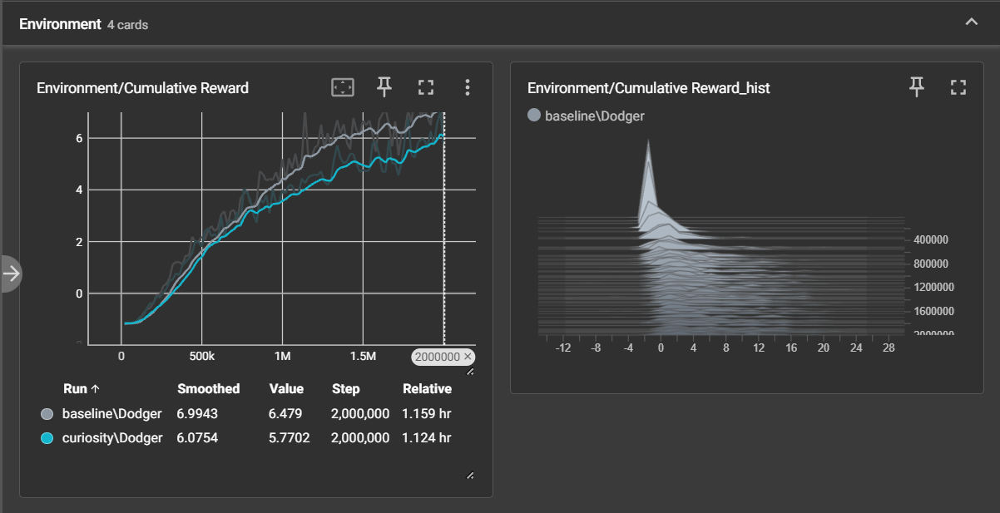

# Dodge Arena



A reinforcement learning agent that learns to **collect targets while dodging incoming projectiles** in a 3D arena.
Built with **Unity** and **Unity ML-Agents**, and trained with **PPO** (Proximal Policy Optimization).

The agent starts out knowing nothing. After 2 million training steps it collects about 8 targets per episode
while moving out of the way of balls flying at it.

## The task

- A walled 20 × 20 arena with 3 obstacles that move to random positions every episode.
- One target at a time. Touching it gives a reward and a new target appears somewhere else.
- Balls are fired at the agent from random edges of the arena every 1.5 seconds. A hit ends the episode.
- Obstacles block balls, so standing behind them is a valid strategy the agent can discover on its own.

## How the agent works

**Observations**
- A 3D ray sensor (17 rays spread all around the agent) that detects targets, balls and walls.
  The last 3 frames are stacked, so the agent can tell which way a ball is moving.
- 5 numbers: its own velocity (2), the direction to the target (2) and the distance to the target (1).

**Actions** (continuous)
- Move forward / backward
- Turn left / right

**Rewards**

| Event | Reward |
|---|---|
| Collect a target | +1 |
| Hit by a ball | −1 (episode ends) |
| Touching a wall or obstacle | −0.005 per step |
| Every step | −1 / 2000 (encourages speed) |

## Training

- Algorithm: PPO (actor–critic), via `mlagents-learn`
- 9 copies of the arena train in parallel to collect experience faster
- 2 million steps per run, about 70 minutes on a laptop CPU
- Network: 2 hidden layers × 128 units
- Main hyperparameters: learning rate 3e-4 (linear decay), batch 1024, buffer 10240, 3 epochs,
  entropy β 5e-3, clip ε 0.2, GAE λ 0.95, discount γ 0.99

All settings are in [`dodger_baseline.yaml`](Assets/Training/dodger_baseline.yaml) with a short comment on each.

## Results

Two runs were compared: a **baseline** and a run with an extra **curiosity** reward
([`dodger_curiosity.yaml`](Assets/Training/dodger_curiosity.yaml)).



| Run | Mean reward at start | Mean reward after 2M steps |
|---|---|---|
| Baseline | −1.2 | **7.0** |
| Curiosity | −1.2 | 6.1 |

Both runs learn at the same pace until about 600k steps; after that the baseline pulls ahead.

**Why curiosity did not help:** curiosity rewards the agent for situations it cannot predict yet,
which helps when real rewards are rare. Here rewards are frequent: a new target appears after every pickup
and hits are punished immediately. The extra signal mostly distracted the agent from the targets.

## Project structure

```
Assets/
  Scripts/
    DodgeAgent.cs      the agent: observations, actions, rewards, episode reset
    BallSpawner.cs     fires balls at the agent
    Ball.cs            moves a ball and removes it when it leaves the arena or hits a wall
    ScoreDisplay.cs    on-screen score (visual only)
    Tags.cs            tag names shared by the scripts
  Training/
    dodger_baseline.yaml, dodger_curiosity.yaml   training configs
    results/           trained models (.onnx) and TensorBoard logs
  Scenes/MyArena.unity           scene with 9 arenas
  Prefabs/MyTrainingArea.prefab  one arena
```

## Running it

**Requirements:** Unity 6 (6000.x), Unity ML-Agents package 4.2.0, Python 3.10 with `mlagents` 1.1.0.

**Watch the trained agent**
1. Open the project in Unity and load `Assets/Scenes/MyArena.unity`.
2. The agents already use the trained model `results/baseline/Dodger.onnx`. Press Play.

**Train it yourself**
```bash
pip install mlagents==1.1.0 torch==2.1.2 "setuptools<70"
cd Assets/Training
mlagents-learn dodger_baseline.yaml --run-id=my_run
```
Press Play in Unity when asked. Watch progress with `tensorboard --logdir results`.

---

Made as a course project for Practical Reinforcement Learning at the University of Debrecen.
